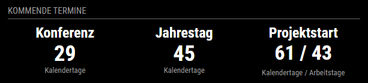
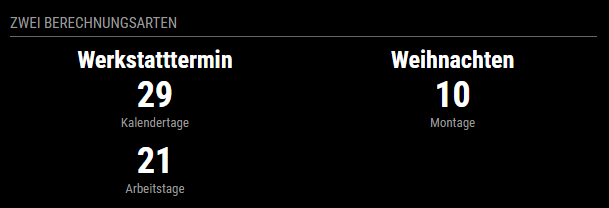
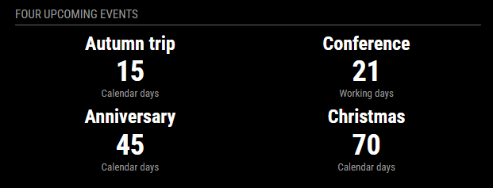

# MMM-CalendarAwareCountdown

[English](README.md) | **Deutsch**

Ein Multi-Countdown-Modul für MagicMirror² mit Kalender-, Arbeits- und
Feiertagsberechnung. Es zeigt Kalendertage, regionale Arbeitstage, ausgewählte
Wochentage und eine laufende Zeitdauer an. Gesetzliche Feiertage und zusätzlich
konfigurierte, nicht anzurechnende Tage können dabei berücksichtigt werden.

Version 1.0 ist die erste stabile Veröffentlichung. Die nachfolgend beschriebenen
Berechnungsregeln und Konfigurationsschlüssel bilden die unterstützte V1-Schnittstelle.

## Funktionen

- Mehrere Countdowns in einem responsiven Raster
- Berechnung von Kalendertagen anhand lokaler Datumswerte
- Arbeitstage anhand einer konfigurierbaren Arbeitswoche
- Feiertage auf Landesebene und für verfügbare Untergliederungen weltweit über
  `date-holidays`
- Gemeindegenaue bayerische Feiertage aus amtlichen lokalen Daten
- Globale und countdownspezifische Ausnahmen als einzelne nicht anzurechnende
  Tage oder Zeiträume
- Zählung ausgewählter Wochentage, beispielsweise Montage
- Laufende Anzeige von Tagen, Stunden, Minuten und Sekunden
- Deutsche und englische Beschriftungen
- Lokale Offline-Berechnung; optionale monatliche Online-Prüfung der Datenquellen

## Screenshots

Die Oberflächensprache wird für jede Modulinstanz unabhängig festgelegt. Die
folgenden Beispiele zeigen zwei deutsche und zwei englische Darstellungen. Alle
Aufnahmen entstanden am 15. Oktober 2026; die angezeigten Werte hängen deshalb
von diesem Aufnahmedatum ab.

### Deutsch: drei gleich breite Countdowns

Kalendertage und Arbeitstage können einzeln oder als gemeinsamer Wert angezeigt
werden.



<details>
<summary>Für diesen Screenshot relevante Konfiguration</summary>

```js
{
  module: "MMM-CalendarAwareCountdown",
  position: "top_left",
  header: "Kommende Termine",
  config: {
    language: "de",
    location: {
      timeZone: "Europe/Berlin",
      country: "DE",
      state: "BE",
      municipality: null
    },
    holidaySources: [
      {
        provider: "date-holidays",
        types: ["public"],
        onUnsupportedLocation: "warn"
      }
    ],
    minimumColumnWidth: "140px",
    countdowns: [
      {
        title: "Konferenz",
        target: "2026-11-13",
        calculations: ["calendarDays"]
      },
      {
        title: "Jahrestag",
        target: "2026-11-29",
        calculations: ["calendarDays"]
      },
      {
        title: "Projektstart",
        target: "2026-12-15",
        calculations: ["calendarDays", "workdays"]
      }
    ]
  }
}
```

</details>

### Deutsch: zwei Berechnungsdarstellungen

Ein Countdown zeigt Kalender- und Arbeitstage in getrennten Zeilen; der andere
zählt ausschließlich Montage.



<details>
<summary>Für diesen Screenshot relevante Konfiguration</summary>

```js
{
  module: "MMM-CalendarAwareCountdown",
  position: "top_left",
  header: "Zwei Berechnungsarten",
  config: {
    language: "de",
    location: {
      timeZone: "Europe/Berlin",
      country: "DE",
      state: "BE",
      municipality: null
    },
    holidaySources: [
      {
        provider: "date-holidays",
        types: ["public"],
        onUnsupportedLocation: "warn"
      }
    ],
    minimumColumnWidth: "240px",
    countdowns: [
      {
        title: "Werkstatttermin",
        target: "2026-11-13",
        display: "separate",
        calculations: ["calendarDays", "workdays"]
      },
      {
        title: "Weihnachten",
        target: "2026-12-24",
        calculations: [
          {
            type: "weekday",
            daysOfWeek: [1]
          }
        ]
      }
    ]
  }
}
```

</details>

### Englisch: laufende Zeitdauer

Ein genauer Zeitpunkt kann als kontinuierlich aktualisierte Dauer einschließlich
Sekunden angezeigt werden.


<details>
<summary>Für diesen Screenshot relevante Konfiguration</summary>

```js
{
  module: "MMM-CalendarAwareCountdown",
  position: "top_left",
  header: "Live countdown",
  config: {
    language: "en",
    location: {
      timeZone: "Europe/Berlin",
      country: "DE",
      state: "BE",
      municipality: null
    },
    holidaySources: [{ provider: "none" }],
    minimumColumnWidth: "420px",
    countdowns: [
      {
        title: "Weekend trip",
        target: "2026-10-24T08:00:00+02:00",
        calculations: [
          {
            type: "duration",
            showSeconds: true
          }
        ]
      }
    ]
  }
}
```

</details>

### Englisch: responsiver Zeilenumbruch

Vier gleich breite Countdowns brechen automatisch in ein Raster mit zwei Zeilen
und zwei Spalten um, wenn die MagicMirror-Region für eine einzelne Zeile zu
schmal ist.



<details>
<summary>Für diesen Screenshot relevante Konfiguration</summary>

```js
{
  module: "MMM-CalendarAwareCountdown",
  position: "top_left",
  header: "Four upcoming events",
  config: {
    language: "en",
    location: {
      timeZone: "Europe/Berlin",
      country: "DE",
      state: "BE",
      municipality: null
    },
    holidaySources: [
      {
        provider: "date-holidays",
        types: ["public"],
        onUnsupportedLocation: "warn"
      }
    ],
    minimumColumnWidth: "240px",
    countdowns: [
      {
        title: "Autumn trip",
        target: "2026-10-30",
        calculations: ["calendarDays"]
      },
      {
        title: "Conference",
        target: "2026-11-13",
        calculations: ["workdays"]
      },
      {
        title: "Anniversary",
        target: "2026-11-29",
        calculations: ["calendarDays"]
      },
      {
        title: "Christmas",
        target: "2026-12-24",
        calculations: ["calendarDays"]
      }
    ]
  }
}
```

</details>

## Installation

Im MagicMirror-Verzeichnis `modules`:

```sh
git clone https://github.com/spitzlbergerj/MMM-CalendarAwareCountdown.git
cd MMM-CalendarAwareCountdown
npm ci --omit=dev
```

Nach dem Einfügen des Moduls in `config/config.js` muss MagicMirror neu gestartet
werden.

## Beispielkonfiguration

```js
{
  module: "MMM-CalendarAwareCountdown",
  position: "top_center",
  header: "Kommende Termine",
  config: {
    language: "de",
    location: {
      timeZone: "Europe/Berlin",
      country: "DE",
      state: "BE",
      municipality: null
    },
    holidaySources: [
      {
        provider: "date-holidays",
        types: ["public"],
        onUnsupportedLocation: "warn"
      }
    ],
    minimumColumnWidth: "140px",
    sourceHealth: {
      enabled: true,
      checkInterval: 30 * 24 * 60 * 60 * 1000,
      requestTimeout: 15000,
      repositoryStaleAfterDays: 365,
      showUnavailable: true
    },

    customDaysOff: [
      "2030-05-10",
      { start: "2030-08-05", end: "2030-08-09", label: "Urlaub" }
    ],

    countdowns: [
      {
        title: "Konferenz",
        target: "2030-09-15",
        calculations: ["calendarDays"]
      },
      {
        title: "Jahrestag",
        target: "2030-10-20",
        calculations: ["calendarDays"]
      },
      {
        title: "Projektstart",
        target: "2030-12-01",
        daysOff: [
          { start: "2030-11-04", end: "2030-11-05", label: "Nur Projekt" }
        ],
        calculations: ["calendarDays", "workdays"]
      }
    ]
  }
}
```

Werden unter `calculations` genau zwei Berechnungen angegeben, zeigt das Modul
die beiden Ergebnisse standardmäßig in derselben Reihenfolge als
`Ergebnis 1 / Ergebnis 2` an, beispielsweise `120 / 78`. Mit
`display: "separate"` werden die beiden Ergebnisse stattdessen jeweils mit ihrer
Bezeichnung in getrennten Zeilen dargestellt.

Das Raster erzeugt so viele gleich breite Spalten, wie die verfügbare
MagicMirror-Region aufnehmen kann. Weitere Countdowns fließen in eine neue
Zeile. `minimumColumnWidth` bestimmt, ab welcher Breite umgebrochen wird; eine
feste Spaltenanzahl gibt es nicht.

## Zählweise

Das Modul zählt das Intervall **einschließlich heute, aber ausschließlich des
Zieldatums**. Mathematisch entspricht das `[heute, Ziel)`. Dadurch entsteht das
gewohnte Ergebnis einer Differenz zwischen zwei Kalenderdaten. Vom 01.01.2030
bis zum 31.01.2030 ergeben sich beispielsweise 30 Kalendertage.

Für die Berechnung von Arbeitstagen wird ebenfalls das Intervall
`[heute, Ziel)` verwendet. Folgende Tage werden dabei nicht als Arbeitstage
mitgezählt:

1. Wochentage, die nicht in `workWeekdays` enthalten sind,
2. gesetzliche Feiertage der konfigurierten Landes- oder Regionszuordnung,
3. Datumswerte aus den globalen `customDaysOff`,
4. Datumswerte aus `daysOff` des jeweiligen Countdowns.

Alle Einträge in `customDaysOff` und `daysOff` bezeichnen ganze Kalendertage. Am
Zieldatum zeigt der Countdown `0`. Nach dem Zieldatum bleibt er sichtbar und
zeigt `-`.

### Einzelne nicht anzurechnende Tage und Zeiträume

Ein einzelner nicht anzurechnender Tag wird als Datumszeichenfolge angegeben,
ein Zeitraum als Objekt:

```js
customDaysOff: [
  "2027-01-04",
  { start: "2027-05-03", end: "2027-05-10", label: "Urlaub" }
]
```

Sowohl `start` als auch `end` werden mitgezählt. Der Beispielzeitraum umfasst
also sämtliche Kalendertage vom 3. bis einschließlich 10. Mai. Trotzdem wird
nicht jeder darin enthaltene Kalendertag automatisch vom Arbeitstageergebnis
abgezogen. Ein Datum reduziert `workdays` nur, wenn alle folgenden Bedingungen
erfüllt sind:

1. Es liegt innerhalb von `[heute, Ziel)`.
2. Es gehört zu den konfigurierten `workWeekdays`.
3. Es ist nicht bereits ein gesetzlicher Feiertag.
4. Es wurde nicht bereits durch einen anderen, überlappenden Eintrag
   ausgeschlossen.

Dadurch wird kein Tag doppelt abgezogen. Bei einer Arbeitswoche von Montag bis
Freitag beeinflussen Samstage und Sonntage innerhalb eines solchen Zeitraums das
Ergebnis nicht. Ist ein nicht anzurechnender Tag zugleich ein gesetzlicher
Feiertag, ist er bereits ausgeschlossen und wird nicht ein zweites Mal
abgezogen. Ein Zeitraum, der erst am Zieldatum beginnt, hat keine Auswirkung,
weil das Zieldatum nicht zum Berechnungsintervall gehört.

Globale `customDaysOff` werden bei allen Countdowns nicht angerechnet. Die
`daysOff` eines Countdowns gelten nur für diesen Countdown. Beide Listen
verwenden dasselbe Format für einzelne Datumswerte und inklusive Zeiträume;
doppelte Datumswerte werden beim Zusammenführen entfernt.

Eine `weekday`-Berechnung zählt die ausgewählten Wochentage standardmäßig
unabhängig von Feiertagen. Mit `excludeHolidays` oder `excludeCustomDaysOff` auf
`true` werden nur anrechenbare Tage gezählt.

## Hauptkonfiguration

| Option | Standardwert | Bedeutung |
| --- | --- | --- |
| `language` | `de` | Sprache der Moduloberfläche und Feiertagsdaten |
| `location` | siehe Beispiel | Gemeinsamer Standort für Feiertagsquellen |
| `holidaySources` | `date-holidays` | Eine oder mehrere Quellen für Feiertagsdaten |
| `workWeekdays` | `[1,2,3,4,5]` | ISO-Wochentage; Montag ist 1, Sonntag ist 7 |
| `customDaysOff` | `[]` | Global nicht anzurechnende Einzeldaten und inklusive Zeiträume |
| `minimumColumnWidth` | `220px` | Mindestbreite, bevor gleich breite Spalten umbrechen |
| `showMetricLabels` | `true` | Bezeichnungen unter den Werten anzeigen |
| `showSourceWarnings` | `true` | Warnung nach einem Standort-Rückfall anzeigen |
| `sourceHealth` | siehe unten | Optionale Online-Wartungsprüfung; die Berechnung bleibt lokal |
| `updateInterval` | `3600000` | Intervall der vollständigen Neuberechnung in Millisekunden |
| `animationSpeed` | `500` | Dauer der MagicMirror-DOM-Aktualisierung in Millisekunden |

`language` wird für jede Modulinstanz getrennt ausgewertet. Die Einstellung
bestimmt sichtbare Überschriften, Metrikbezeichnungen und Dauereinheiten sowie
die beim Feiertagsanbieter angeforderte Sprache. Mitgeliefert werden `de` und
`en`. Ein regionaler Wert wie `de-DE` oder `en-GB` fällt auf seine Basissprache
zurück, wenn keine eigene regionale Übersetzungsdatei vorhanden ist.

### Countdown-Konfiguration

| Option | Standardwert | Bedeutung |
| --- | --- | --- |
| `title` | erforderlich | Überschrift über dem Wert |
| `target` | erforderlich | `YYYY-MM-DD` oder ein ISO-Zeitstempel für `duration` |
| `calculations` | `["calendarDays"]` | Eine oder mehrere Berechnungsdefinitionen |
| `daysOff` | `[]` | Nur für diesen Countdown nicht anzurechnende Einzeldaten und inklusive Zeiträume |
| `display` | `auto` | `auto` zeigt genau zwei Berechnungsergebnisse als `Ergebnis 1 / Ergebnis 2`; `separate` zeigt jedes Ergebnis in einer eigenen Zeile |

### Standort

| Option | Bedeutung |
| --- | --- |
| `timeZone` | IANA-Zeitzone zur Bestimmung des aktuellen lokalen Datums |
| `country` | ISO-3166-1-Alpha-2-Ländercode |
| `state` | Optionaler Code einer staatlichen Untergliederung |
| `municipality` | Optionaler Gemeindename für genauere lokale Regeln |
| `municipalityCode` | Optionaler amtlicher Code bei mehrdeutigen Gemeindenamen |

### Feiertagsquellen und Abdeckung

Version 1 gibt folgende ausdrückliche Unterstützungszusage:

- Feiertagsberechnung auf Landesebene für jedes in
  [`date-holidays`](https://github.com/commenthol/date-holidays) verfügbare Land,
  derzeit mehr als 200 Länder,
- Berechnung für Bundesländer, Provinzen, Kantone oder Regionen, soweit der
  Anbieter diese Untergliederung bereitstellt,
- Berechnung auf Gemeindeebene, wenn das Modul einen eigenen lokalen Auflöser
  enthält; zunächst für alle bayerischen Gemeinden,
- manuelle Korrektur oder Ergänzung mit globalen `customDaysOff` und
  countdownspezifischen `daysOff`.

Die Feiertagsberechnung verwendet austauschbare Anbieter. Version 1 enthält:

| Anbieter | Netzwerk | Abdeckung |
| --- | --- | --- |
| `date-holidays` | Nein | Länder und von der Bibliothek bereitgestellte Untergliederungen/Regionen |
| `none` | Nein | Deaktiviert automatische gesetzliche Feiertage |

Das Modul behauptet keine Gemeindepräzision, wenn der Anbieter sie nicht
bereitstellt. Jede Quelle meldet, ob sie Landes-, Bundesland-, Regions- oder
Gemeindedaten verwendet hat. Kann eine angeforderte Gemeinde nicht aufgelöst
werden, bestimmt `onUnsupportedLocation` das Verhalten:

- `warn` (Standard): Regeln für Bundesland/Land verwenden und warnen
- `error`: Berechnung abbrechen, statt weniger genaue Daten zu verwenden
- `silent`: Regeln für Bundesland/Land ohne sichtbare Warnung verwenden

Für fortgeschrittene Anwendungsfälle kann an der einzelnen Quelle `region`
gesetzt werden, wenn der Anbieter einen Regionscode kennt, aber keine
automatische Gemeindeauflösung vorhanden ist.

Die Anbietergrenze erlaubt spätere Adapter für einen Webdienst oder einen
iCalendar-Feed, ohne die Countdown-Berechnungen zu ändern. Ein beliebiger
JSON-Endpunkt wird nicht ungeprüft akzeptiert: Jeder Anbieter benötigt ein
definiertes Schema, Validierung, Zwischenspeicherung und eine klare
Rückfallstrategie.

### Interner Anbietervertrag

Feiertagsanbieter geben ihre ursprüngliche Antwort nicht unmittelbar an die
Countdown-Berechnung weiter. Jeder Adapter muss folgende normalisierte Struktur
liefern:

```js
{
  dates: new Set(["2030-01-01", "2030-12-25"]),
  report: {
    provider: "provider-name",
    coverage: "country", // country, state, region, municipality oder none
    status: "exact",     // exact oder fallback
    diagnostics: []
  }
}
```

`dates` darf ausschließlich validierte lokale Datumswerte im Format
`YYYY-MM-DD` enthalten. Mehrere Anbieter werden als Menge zusammengeführt, damit
derselbe Feiertag niemals doppelt abgezogen wird. `report` beschreibt die
tatsächlich erreichte geografische Genauigkeit und mögliche Rückfälle. Das ist
das feste interne Format, in das weitere Datenquellen eingebunden werden. Ein
neuer Webdienst, iCalendar-Feed oder eine nationale Bibliothek benötigt deshalb
nur einen kleinen Adapter, der die Ursprungsdaten prüft und diesen Vertrag
erzeugt; die Berechnungs- und Anzeigeprogramme müssen das ursprüngliche Format
nicht kennen.

## Berechnung von Feiertagen und Arbeitstagen

Die vollständige Berechnung ist bewusst in vier eindeutige Schritte aufgeteilt:

1. `location-resolver.js` ordnet Land, Bundesland und optionale Gemeinde der
   genauesten unterstützten Feiertagsregion zu. Außerdem meldet die Datei, ob
   das Ergebnis exakt ist oder einen dokumentierten Rückfall verwendet.
2. `holiday-sources.js` fragt jeden konfigurierten Anbieter für alle von den
   aktiven Countdowns betroffenen Jahre ab und normalisiert die Ergebnisse zu
   einer Menge von Datumsschlüsseln.
3. `countdown-calculator.js` durchläuft `[heute, Ziel)`. Ein Datum ist nur dann
   ein Arbeitstag, wenn sein ISO-Wochentag in `workWeekdays` enthalten ist, es
   nicht in der Feiertagsmenge liegt und nicht in den zusammengeführten globalen
   beziehungsweise countdownspezifischen Ausschlussdaten enthalten ist.
4. Der Browser erhält ausschließlich fertig berechnete Werte und Diagnosen. Er
   bildet keine Feiertagsregeln nach und kann daher nicht versehentlich anders
   rechnen.

`date-holidays` wird lokal in exakt der in `package-lock.json` festgehaltenen
Version installiert. Der normale Countdown-Betrieb ruft deshalb keinen
Webdienst auf und funktioniert ohne Internetzugang. Die weiter unten
beschriebene Quellenprüfung verändert niemals ein Ergebnis während einer
Berechnung.

## Berechnungsarten

| Typ | Ergebnis |
| --- | --- |
| `calendarDays` | Lokale Kalendertage bis zum Ziel |
| `workdays` | Konfigurierte Arbeitstage ohne Feiertage und zusätzlich ausgeschlossene Tage |
| `weekday` | Vorkommen ausgewählter ISO-Wochentage |
| `duration` | Laufende Dauer bis zu einem exakten Zeitpunkt |

Für `duration` wird ein ISO-Zeitstempel mit UTC-Versatz empfohlen, beispielsweise
`2027-08-14T06:00:00+02:00`. Dadurch ist der gemeinte Zeitpunkt eindeutig.

## Bayerische Gemeindedaten

Die bayerische Sonderbehandlung ist bewusst klein und nachvollziehbar:

- Deutschland/Bayern ohne Gemeinde verwendet die normalen bayerischen
  Landesregeln aus `date-holidays`.
- Bei angegebener Gemeinde sucht `location-resolver.js` deren amtlichen
  achtstelligen Code und den Status von Mariä Himmelfahrt in
  `data/DE-BY-municipalities.json`.
- Der Code `09761000` (Augsburg) wählt die Anbieterregion `A`, die das Augsburger
  Friedensfest am 8. August enthält.
- Jede andere Gemeinde verwendet `KATH`, wenn die amtliche Zuordnung Mariä
  Himmelfahrt als Feiertag ausweist, andernfalls `EVANG`.

Dabei handelt es sich nicht um eine manuell gepflegte Liste lokaler Feiertage.
Die Zuordnung wird aus der
[Gemeindedatenbank des Bayerischen Landesamts für Statistik](https://www.statistik.bayern.de/statistik/gebiet_bevoelkerung/zensus/himmelfahrt/)
erzeugt. Nach
[Artikel 1 des Bayerischen Feiertagsgesetzes](https://www.gesetze-bayern.de/Content/Document/BayFTG-1)
bestimmt dieses Amt anhand des neuesten Zensus die betroffenen Gemeinden; das
Augsburger Friedensfest ist im selben Gesetz gesondert geregelt. Die aktuelle
amtliche Seite erklärt, dass die Einteilung des Zensus 2022 seit dem 15. August
2025 gilt.

Die Seite der Behörde ist eine verlässliche Primärquelle, aber eine HTML-Datenbank
und keine versionierte Programmierschnittstelle. Der Importer bricht deshalb bei
Abweichungen sicher ab: Er akzeptiert einen Download nur, wenn alle 2.056
Gemeindedatensätze vorhanden, alle amtlichen Codes eindeutig und sämtliche
Pflichtfelder gültig sind. Eine geänderte Seitenstruktur führt zu einem sichtbaren
Fehler der Quellenprüfung, statt eine unvollständige Liste unbemerkt zu
übernehmen. Laufende Berechnungen verwenden ausschließlich die geprüften Daten,
die mit der jeweiligen Modulversion ausgeliefert wurden.

Verantwortliche können die eingecheckten Daten folgendermaßen aktualisieren:

```sh
npm run update:bavaria-municipalities
```

Die erzeugte Datei enthält die genaue Quelladresse, Rechts-/Datengrundlage und
den Erstellungszeitpunkt. `NOTICE.md` enthält die Quellenangabe.

## Quellenaktualisierung und monatliche Wartung

Version 1 trennt zwei unterschiedliche Vorgänge bewusst voneinander:

1. **Abrufen und prüfen:** aktuelle Metadaten/Daten beziehen, validieren und mit
   der installierten Version vergleichen.
2. **Aktualisierung installieren:** Abhängigkeit oder mitgelieferte Gemeindedatei
   ändern, alle Tests erneut ausführen, das Ergebnis prüfen und eine neue
   Modulversion veröffentlichen beziehungsweise installieren.

Der erste Vorgang ist automatisiert. Der zweite wird nicht unbemerkt auf einem
laufenden Spiegel ausgeführt, weil fremder Programmcode oder geänderte amtliche
Daten sonst Ergebnisse ohne Tests, Prüfung oder Rückrollmöglichkeit verändern
könnten.

### Prüfungen durch das laufende Modul

Mit `sourceHealth.enabled: true` (Standard) führt der Node-Helper höchstens alle
30 Tage folgende Online-Prüfungen durch und speichert das Ergebnis in
`.cache/source-health.json`:

- Vergleich der festgeschriebenen `date-holidays`-Version mit der aktuellen
  npm-Veröffentlichung,
- Prüfung über die GitHub-Repository-Metadaten, ob das Upstream-Repository weder
  archiviert noch deaktiviert ist; Warnung, wenn der letzte Push länger als
  `repositoryStaleAfterDays` zurückliegt,
- Herunterladen und vollständige Prüfung der amtlichen bayerischen
  Gemeindetabelle sowie Vergleich der berechnungsrelevanten Felder mit der
  mitgelieferten Zuordnung.

Nur ein verfügbares Update, eine ungültige/veraltete Quelle oder eine nicht
erreichbare Prüfung erscheint als kleine Fußzeile unter den Countdowns. Gesunde
Quellen bleiben unsichtbar. Die Fußzeile berücksichtigt außerdem die aktive
Konfiguration: Bayerische Gemeindedaten erscheinen nur bei einer konfigurierten
bayerischen Gemeinde; Hinweise zu `date-holidays` erscheinen nur, wenn dieser
Anbieter aktiviert ist.

Eine unerreichbare oder ungültige Prüfquelle macht lokal berechnete Countdowns
nicht ungültig. „Unerreichbar“ bedeutet, dass die Aktualität wegen eines
Transport- oder HTTP-Fehlers nicht geprüft werden konnte. „Ungültig“ bedeutet,
dass eine erreichbare Antwort das erwartete Schema oder die
Vollständigkeitsprüfung nicht erfüllt hat. Fehlgeschlagene Netzwerkprüfungen
werden bereits nach einem Tag erneut versucht und nicht einen ganzen Monat lang
zwischengespeichert.

| Option in `sourceHealth` | Standardwert | Bedeutung |
| --- | --- | --- |
| `enabled` | `true` | Optionale Online-Wartungsprüfung einschalten |
| `checkInterval` | `2592000000` | Speicherdauer eines gesunden Ergebnisses (30 Tage) |
| `requestTimeout` | `15000` | Maximale Wartezeit pro HTTPS-Anfrage in Millisekunden |
| `repositoryStaleAfterDays` | `365` | Nach dieser Zahl von Tagen ohne Upstream-Push warnen |
| `showUnavailable` | `true` | Fußzeile anzeigen, wenn eine Quelle nicht geprüft werden konnte |

Mit `enabled: false` arbeitet die Installation vollständig offline. Dadurch
werden nur Aktualitätshinweise deaktiviert; sämtliche Feiertags- und
Countdown-Berechnungen verwenden in beiden Betriebsarten die lokal
veröffentlichten Daten.

### Prüfungen durch das GitHub-Repository

`.github/workflows/monthly-source-check.yml` läuft am ersten Tag jedes Monats
und kann zusätzlich manuell gestartet werden. Der Ablauf installiert exakt die
Sperrdatei, führt alle Tests aus und startet:

```sh
npm run check:sources
```

Der Auftrag schlägt bei jedem prüfungsbedürftigen Quellenzustand fehl, sodass die
normalen GitHub-Actions-Benachrichtigungen die Verantwortlichen informieren.
`.github/dependabot.yml` eröffnet zusätzlich monatlich einen Pull Request, wenn
npm-Abhängigkeiten aktualisiert werden können. Keiner dieser Mechanismen
übernimmt Gemeindedaten oder veröffentlicht selbstständig eine neue Version.

Eine verantwortliche Quellenaktualisierung besteht deshalb aus:

1. fehlgeschlagene Prüfung oder Dependabot-Pull-Request untersuchen,
2. bei Gemeindeänderungen `npm run update:bavaria-municipalities` ausführen,
3. genaue Datenänderung und amtliche Grundlage prüfen,
4. `npm ci`, `npm run check` und `npm run check:sources` ausführen,
5. eine neue markierte Version veröffentlichen und installieren.

Dieser Zyklus prüft sowohl Datenänderungen als auch, ob die wichtigste
Abhängigkeit weiterhin gepflegt erscheint. Die zukünftige Pflege durch Dritte
kann er nicht garantieren; ein archiviertes, deaktiviertes oder ungewöhnlich
inaktives Repository wird sichtbar gemacht, damit der Anbieter bewusst ersetzt
werden kann.

## Entwicklung

Die Berechnungsprogramme sind bewusst von MagicMirror unabhängig:

```sh
npm test
```

Dadurch können Datumsregeln ohne laufenden MagicMirror und ohne Browser getestet
werden.

Vor einer Veröffentlichung:

```sh
npm ci
npm run check
npm pack --dry-run
```

V1 wurde mit MagicMirror² 2.38.0 und Node.js 24 auf einem Raspberry Pi getestet.
Das Paket benötigt Node.js 22 oder neuer.

## Datenquellen

Die mitgelieferte bayerische Gemeindezuordnung wurde aus Daten des Bayerischen
Landesamts für Statistik abgeleitet. Die genaue Quelle und der Umfang sind in
[`NOTICE.md`](NOTICE.md) beschrieben. JavaScript-Abhängigkeiten Dritter behalten
ihre jeweiligen Lizenzen.

## Lizenz

MIT
